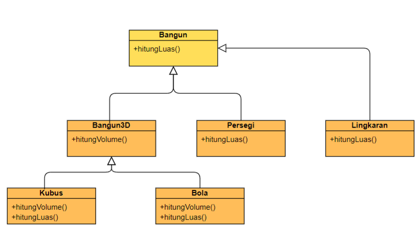

# 2D and 3D Shapes — Inheritance and Abstract Class

## Description

You are required to implement a hierarchy of classes representing 2D and 3D shapes with the following structure:

- An abstract class **Bangun** with an abstract method `hitungLuas()`.
- Classes **Persegi** and **Lingkaran** derive from **Bangun** and implement `hitungLuas()`.
- An abstract class **Bangun3D** derives from **Bangun** and adds an abstract method `hitungVolume()`.
- Classes **Kubus** and **Bola** derive from **Bangun3D** and implement both `hitungLuas()` (to calculate the surface area) and `hitungVolume()`.

Given a series of 3D objects and their sizes, compute the total surface area (including areas of 2D objects, if any) and the total volume for all 3D objects.

**Use PI = 3.1425.**

### Class Hierarchy



## Input Format

- The first line contains an integer *N* (1 ≤ *N* ≤ 1000), representing the number of objects.
- Each of the following *N* lines contains a character and a floating-point number separated by a space:
  - **P**: Persegi (square)
  - **L**: Lingkaran (circle)
  - **K**: Kubus (cube)
  - **B**: Bola (sphere)

The floating-point number represents the size (side length for square and cube, radius for circle and sphere).

## Constraints

- 1 ≤ *N* ≤ 1000
- 1 ≤ *Ai* ≤ 1,000,000 (for the size of each object)

## Output Format

Print two lines:

- The first line is the total surface area of all objects (2D shapes and surface areas of 3D shapes) with two decimal places.
- The second line is the total volume of all 3D objects with two decimal places.

## Sample Input 0

```
5
L 5.6
P 2.5
K 8.8
B 2.3
L 7.1
```

## Sample Output 0

```
794.35
732.45
```

## Explanation 0

- For **Lingkaran (L)**: Calculate area = PI × r².
- For **Persegi (P)**: Calculate area = side².
- For **Kubus (K)**: Calculate surface area = 6 × side² and volume = side³.
- For **Bola (B)**: Calculate surface area = 4 × PI × r² and volume = (4/3) × PI × r³.

The first output line sums the areas of all shapes (2D and surface areas of 3D shapes). The second output line sums the volumes of only the 3D shapes.